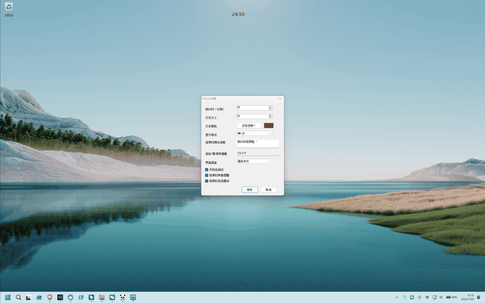

<div align="center">

#  iClock

### Ultra-Lightweight (300 KB) Windows Native Productivity Hub
**⏱ Transparent Floating Timer · 💬 Ambient Daily Quotes · 🤖 AI Agent Monitor & Native MCP Server**

[](https://github.com/francodeyvison183-collab/iClock/releases/latest)
[](https://github.com/francodeyvison183-collab/iClock/releases/latest)
[](https://github.com/francodeyvison183-collab/iClock/releases/latest)
[](https://github.com/microsoft/winget-pkgs/pull/449511)
[](https://github.com/francodeyvison183-collab/iClock)
[](mailto:francodeyvison183@gmail.com)
[](LICENSE)

<p align="center">
  <b>Single 300 KB Binary · RAM &lt; 15 MB · 0.0% CPU Idle · Full Mouse Click-Through · Zero-Polling Daily Quotes · Native MCP Agent Hub</b>
</p>

<p align="center">
  <a href="https://francodeyvison183-collab.github.io/iClock/"><b>🌐 Website</b></a> ·
  <a href="https://github.com/francodeyvison183-collab/iClock/releases/latest"><b>🚀 Download Latest (ZIP Archive · Recommended)</b></a> ·
  <a href="https://francodeyvison183-collab.github.io/iClock/llms.txt"><b>🤖 llms.txt</b></a> ·
  <a href="README.md"><b>简体中文说明</b></a> ·
  <a href="docs/USER_GUIDE.md">User Guide</a> ·
  <a href="CHANGELOG.md">Changelog</a>
</p>



</div>

---

## 💡 Why iClock?

Desktop tools often fall into two extremes: either crude and single-purpose, or bloated **100MB+** Electron packages that continuously consume CPU and hundreds of megabytes of RAM, often bundled with telemetry or ads, while their opaque windows obstruct your code and web workspace.

**iClock adheres to extreme engineering minimalism**: built on Windows native Win32 and GDI+ APIs with zero external runtimes or dependencies, packing a **300 KB** standalone executable with an active RAM footprint under **15 MB**. It is not merely a click-through desktop countdown timer, but a cohesive productivity hub integrating **zero-polling ambient daily quotes** and **native Model Context Protocol (MCP) agent collaboration**.

---

## 🌟 Three Core Features

### 1. ⏱ The Minimalist Focus Timer
* 🪟 **Native 32-bit ARGB & Full Click-Through**: Powered by Windows native `UpdateLayeredWindow`, delivering pristine subpixel anti-aliasing without jagged monochrome edges; adaptive soft drop shadows ensure crystal-clear contrast across light, dark, or busy backgrounds; default `WS_EX_TRANSPARENT` click-through never steals focus from your IDE, terminal, or full-screen games.
* ⌨️ **Ergonomic Direct Drag & Tray Scroll**: Reposition instantly by **holding `Alt` + left-click dragging** anywhere on the digits; hover over the tray icon and **scroll your mouse wheel to adjust duration** (`±1m`, or `±5m` with `Shift`); default `Ctrl + Shift + T` global hotkey.
* 🔔 **Tiered Alerts & Auto Fullscreen DND**: Choose between a **TopMost Popup Dialog** (with classic mechanical telephone ring or chime for critical deadlines) or an **In-Place Breathing Pulse** (desktop digits gently breathe for 5 seconds with a soft chime without stealing window focus). Built-in **Auto Fullscreen DND** automatically downgrades popups to subtle breathing pulses whenever full-screen DirectX/Vulkan games, PPT slideshows, or video playback are detected in the foreground.
* 📊 **History Logs & Multi-Day Analytics**: Review both [Daily Breakdown] and [Multi-Day Aggregate] (7, 14, 30 days or all-time) with total focus duration, completed sessions, achievement ratings, and TSV archival.

### 2. 💬 Ambient Desktop Inspiration (Daily Quotes)
* 🌅 **Morning Unlock & Desktop Pinning**: Gracefully fades in centered upon morning system unlock; pin to wallpaper or leave floating permanently.
* ⚡ **0-Polling Hibernation Architecture**: Engineered around Windows native event messages without background cursor polling loops: consumes **0 wakeups and 0.0% CPU** while idling on your desktop.
* 🎨 **Direct Desktop Micro-Interactions**: **Hold `Alt` + drag** quote text to reposition, drag the right edge to adjust wrap width, and use **`Alt + Ctrl + Wheel` to scale font size**; double-click to skip to the next quote.
* 📚 **Offline Library & AI Expansion**: Includes 300+ bilingual curated quotes and notepad editing for `quotes.txt`. In Settings, trigger your local AI Agent / MCP to **batch-generate 30 new quotes** with automatic deduplication and safe `quotes.txt.bak` backup.

### 3. 🤖 AI Agent Collaboration & Native MCP Server
* 👁 **20+ Programming Agents Monitored**: Automated perception for Cursor, Antigravity, Claude Code, GitHub Copilot, Windsurf, Trae, Tongyi Lingma, CodeGeeX, MiniMax, CodeBuddy, Aider, and more. A 4-tier perception matrix (Toast hooks, `HSHELL_FLASH` window flashing, title scanning, process lifecycle) delivers **0ms instant alert** upon task completion with 1-click window restore.
* 🔌 **Built-in Native stdio MCP Server (`iClock.exe --mcp`)**: The GUI and MCP bridge share one executable. The bridge connects to the desktop process over a local Named Pipe and starts the GUI automatically when needed. It implements Anthropic Model Context Protocol JSON-RPC 2.0 without Node.js or Python dependencies and provides 6 tools:
  - `iclock_ask_human`: **Desktop Decision Gate (Human-in-the-Loop)**. When an AI agent performs dangerous actions (e.g. deleting files, irreversible script execution, production deploy), it triggers a native modal on your desktop to request human authorization and input;
  - `iclock_timer`: Agent sets, queries, and controls countdown timers autonomously;
  - `iclock_notify`: Agent triggers desktop top-most popups, breathing pulses, and chimes upon task milestones;
  - `iclock_quote`: Agent reads or rotates desktop motivational quotes;
  - `iclock_status`: Agent queries runtime system and timer status.
* 💻 **Command Line & Script Automation (CLI & IPC Pipeline)**: Powered by `WM_COPYDATA` IPC with 0ms overhead. Run `iclock --install-cli` once to add iClock to User PATH and call globally without `.exe` (just like `claude` or `git`); integrate with build scripts (`npm run build && iclock -n "Build Succeeded"`).

---

## 📊 Comparison

| Metric | **iClock (This Project)** | Typical Electron Timer | Windows Clock App | Web Pomodoro Timer |
| :--- | :--- | :--- | :--- | :--- |
| **Package Size** | ⚡ **300 KB** (Portable single exe) | 120 MB ~ 250 MB | Pre-installed | Several MBs on load |
| **Memory (RAM)** | ⚡ **~15 MB** (Physical baseline) | 150 MB ~ 300 MB | ~30 MB | 80 MB ~ 200 MB (Browser tab) |
| **CPU Usage** | ⚡ **0.0%** (Heartbeat aligned) | 0.5% ~ 3.0% (Polling) | 0.0% | 0.3% ~ 1.5% |
| **Interaction** | ⚡ **Full click-through, borderless** | Solid window blocking view | Minimized or full window | Must switch tab to view |
| **Native MCP** | ⚡ **Built-in stdio Server (6 tools)** | ❌ None | ❌ None | ❌ None |
| **AI Agent Monitor**| ⚡ **20+ coding agents supported** | ❌ None | ❌ None | ❌ None |
| **Desktop Quotes** | ⚡ **0-Polling + AI expansion** | ❌ None | ❌ None | ❌ In-page only |
| **Network Traffic**| ⚡ **0 network calls, 100% offline** | Telemetry / Update checks | Microsoft account sync | Cloud telemetry |

---

## 🚀 Quick Start

### Option A: Portable ZIP Archive (Recommended · Avoids browser false warnings)

1. Download **`iClock-1.09-windows.zip`** from [GitHub Releases](../../releases/latest) (recommended to avoid SmartScreen warnings for unsigned `.exe` files).
2. Extract the archive and double-click `iClock.exe` to run (100% portable, zero registry pollution).
3. Upon launch, iClock sits quietly in the system tray ready for action.

### Option B: Windows Official WinGet Package Manager

Run in PowerShell or CMD:
```powershell
winget install FrancoDeyvison.iClock
```

### Option C: Scoop Package Manager

```powershell
scoop install https://raw.githubusercontent.com/francodeyvison183-collab/iClock/main/scoop/iclock.json
```

---

## 🔌 30-Second Setup for Claude Desktop / Cursor (Native MCP)

iClock includes a native stdio MCP bridge (`iClock.exe --mcp`) that requires no Node.js or Python runtime. The GUI and bridge use the same executable; the bridge talks to the running desktop process over a local Named Pipe and starts it automatically if necessary.

### 1. Claude Desktop
Edit `%APPDATA%\Claude\claude_desktop_config.json`:
```json
{
  "mcpServers": {
    "iclock": {
      "command": "C:\\Path\\To\\iClock\\iClock.exe",
      "args": ["--mcp"]
    }
  }
}
```

### 2. Cursor / Windsurf
Add to `.cursor/mcp.json` or through settings:
```json
{
  "mcpServers": {
    "iclock": {
      "command": "C:/Path/To/iClock/iClock.exe",
      "args": ["--mcp"]
    }
  }
}
```

### 3. One-Click Prompt Setup
In iClock Settings ➔ **AI Collaboration**, click **`[ Copy Prompt ]`** to let your AI agent configure its own connection autonomously!

---

## 💻 CLI & Automation Pipeline

iClock features an ultra-lightweight **Win32 IPC (`WM_COPYDATA`)** pipeline. Running secondary commands controls the active background instance with sub-millisecond response.

### 1. Global Terminal Setup (No `.exe` Required)
Run once:
```powershell
iclock --install-cli
```
This adds iClock's directory to your User PATH. You can then invoke `iclock` from any terminal (PowerShell, CMD, Git Bash, Windows Terminal).

### 2. Command Reference

| Command | Shorthand | Description | Example |
| :--- | :--- | :--- | :--- |
| `iclock` | - | Launch or wake background instance | `iclock` |
| `iclock --start [m]` | `iclock -s [m]` | Start work countdown for `[m]` minutes | `iclock -s 25` |
| `iclock --pause` | `iclock -p` | Pause current countdown | `iclock -p` |
| `iclock --resume` | `iclock -r` | Resume paused countdown | `iclock -r` |
| `iclock --toggle` | `iclock -t` | Toggle Pause / Resume | `iclock -t` |
| `iclock --reset` | - | Reset timer to standby and hide digits | `iclock --reset` |
| `iclock --rest [m]` | - | Start rest countdown (default 5 min) | `iclock --rest 10` |
| `iclock -n <message>`| `iclock --notice` | Trigger desktop TopMost popup & chime | `iclock -n "Build Succeeded!"` |
| `iclock -q` | `iclock --quote` | Rotate to next daily quote | `iclock -q` |
| `iclock --install-cli`| - | Add iClock directory to User PATH | `iclock --install-cli` |
| `iclock --help` | `iclock -h` | Print CLI reference manual | `iclock -h` |

### 3. Automation Examples
```bash
# Notify when build completes
npm run build && iclock -n "Production build finished!"

# Notify after automated regression test suite passes
pytest && iclock -n "All 44 test cases passed!"

# Quick 50-minute deep flow session
iclock -s 50
```

---

## 🎯 Keyboard Shortcuts & Micro-Interactions

* **Start / Pause**: Press `Ctrl + Shift + T` or left-click tray icon.
* **Direct Repositioning**: Hold `Alt` + left-click drag anywhere on the countdown digits.
* **Scroll Wheel Duration Adjustment**: Hover over the tray icon and scroll mouse wheel (`±1m`, or `±5m` with `Shift`).
* **Desktop Quotes Interaction**: Hold `Alt` + drag to move, drag right edge to resize width, **`Alt + Ctrl + Wheel` to scale font size**, double-click to rotate quotes, click `📌` to pin to desktop.
* **Settings Dialog**: Right-click tray $\rightarrow$ **Settings** (3 tabs: ⏱ Countdown / 💬 Daily Quotes / 🤖 AI Collaboration).

---

## ❓ Frequently Asked Questions (FAQ)

* **Q: Why doesn't it block mouse clicks while gaming or coding?**  
  **A**: iClock leverages the native Windows `WS_EX_TRANSPARENT` style. Digits render TopMost above all windows, but all mouse clicks and scroll events pass through directly to underlying games, IDEs, and browser tabs.
* **Q: Why is the file size only 300 KB?**
  **A**: Pure native C# WinForms and GDI+ rendering. Zero Electron, zero Chromium runtime, zero bulky third-party DLLs. Memory stays strictly below 15 MB.
* **Q: Does desktop quote hibernation consume laptop battery?**  
  **A**: No. It relies purely on Windows native event messages (0-Polling). Idle CPU consumption is 0.0%, preserving battery life.
* **Q: Which agents are supported by the native MCP server?**  
  **A**: Any tool supporting Anthropic's Model Context Protocol (Claude Desktop, Cursor, Windsurf, Antigravity, etc.), plus any command-line agent via CLI IPC.
* **Q: Is iClock secure and ad-free?**  
  **A**: 100% open source under the MIT License. Zero ads, zero bundled software, zero background telemetry. See [PRIVACY.md](docs/PRIVACY.md).

---

## 🛠️ Building from Source

Build directly with the Windows built-in `csc.exe` (.NET Framework 4.x) — **no Visual Studio installation required**:

```powershell
git clone https://github.com/francodeyvison183-collab/iClock.git
cd iClock
.\build.ps1
```
> Builds in less than a second into `dist/iClock.exe` (about 300 KB). See [BUILDING.md](docs/BUILDING.md).

---

## 🔒 Privacy & Security

* **Storage**: Config and logs reside in portable mode or `%APPDATA%\iClock`.
* **System Changes**: Registry modified only if "Start with Windows" is explicitly checked; `--install-cli` only adds an entry to User PATH.
* **Zero Network Calls**: No telemetry, no background analytics, 100% offline-capable. See [PRIVACY.md](docs/PRIVACY.md).

---

## 💖 Sponsorship & Community

If iClock makes your workspace cleaner and your focus sharper, please give us a ⭐️ **Star** on GitHub!

<div align="center">
  
  <p><b>Buy the author a coffee via WeChat Pay</b></p>
  <p><i>Thank you for supporting indie open-source software!</i></p>
</div>

---

## 👨‍💻 Author & Contact

* **Author & Developer**: `gujiangwen`
* **Email & Feedback**: [`francodeyvison183@gmail.com`](mailto:francodeyvison183@gmail.com)
* **Official Website**: [https://francodeyvison183-collab.github.io/iClock/](https://francodeyvison183-collab.github.io/iClock/)
* **GitHub Repository**: [francodeyvison183-collab/iClock](https://github.com/francodeyvison183-collab/iClock)

Feel free to open an issue, submit a pull request, or send an email with suggestions and feedback!

---

## 📄 License

Distributed under the [MIT License](LICENSE).
